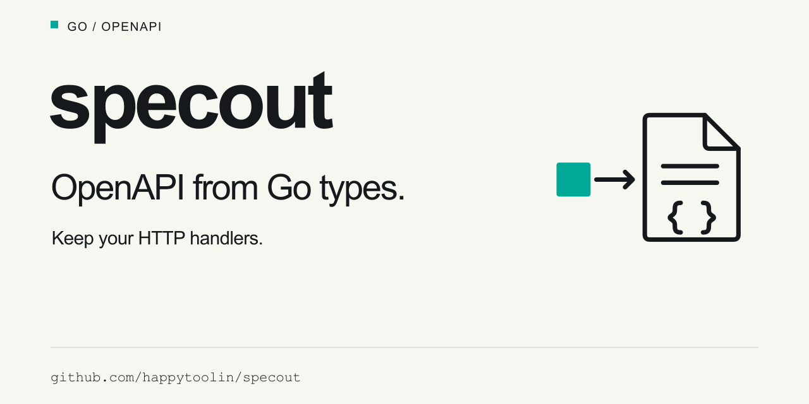

# specout

We built specout to add API docs without replacing your router or changing the
request lifecycle.



Generate OpenAPI from Go types. Keep your existing HTTP handlers.

specout supports `net/http`, chi, gorilla/mux, Echo, Gin, and Fiber. You can
keep your router and middleware.

> **Experimental**
>
> specout is experimental. The public API may change.
> Feedback and reports from real services are welcome.

## How it works

Define request and response types. Add field tags to describe parameters and
bodies. Attach the types to your handler with `specout.Handler[Request, Response]`.

Your handler still gets `http.ResponseWriter` and `*http.Request`. It reads the
request. It validates input. It writes the response.

Tags describe the API contract. Your code must enforce it. specout does not
decode or validate requests. You do not need comment annotations or generated
handlers.

## Why specout?

Use specout when you want API docs for an existing Go service. Keep your router,
middleware, and `http.HandlerFunc` handlers. Your code keeps control of request
parsing, validation, authentication, and response writing.

Each tool has a different approach:

- [Huma](https://huma.rocks/features/operations/) uses typed operation handlers.
  It provides request parsing, validation, and response encoding. It supports
  [several routers](https://huma.rocks/features/bring-your-own-router/).
- [Fuego](https://github.com/go-fuego/fuego#features) is a web framework with
  OpenAPI generation, parsing, validation, and response encoding. It also
  supports standard HTTP handlers.
- [Swaggo's swag](https://github.com/swaggo/swag#getting-started) builds API docs
  from comment annotations. Its CLI generates the documentation files.

specout uses Go types and field tags to describe your API. You do not need
comment annotations or a code generation step. Choose it when you want to add
docs while keeping your current request handling code.

## Supported features

Request and response types describe the API contract. Your code must implement
that contract.

| Feature | Support |
|---|---|
| Document format | OpenAPI 3.1 and JSON Schema 2020-12. |
| Router adapters | `http.ServeMux`, chi, gorilla/mux, Echo v4 and v5, Gin, and Fiber v2 and v3. |
| Other routers | Use `specout.Bind` to write a small adapter, or `specout.Document` for metadata only. |
| Request parameters | Path, query, header, and cookie parameters. |
| Request bodies | JSON, binary files, multipart uploads, and custom media types. |
| Response contracts | Status codes, headers, media types, shared errors, and responses without a body. |
| Go type schemas | Nested and recursive types, collections, optional fields, and nullable values. |
| Schema rules | Enums, formats, value limits, and registered discriminated unions. |
| Authentication docs | Bearer tokens, API keys, OAuth 2.0, and OpenID Connect. Your middleware checks credentials. |
| Route metadata | Summaries, descriptions, tags, operation IDs, and deprecation. |
| Document output | Serve JSON over HTTP or export it with `WriteJSON`. The output has a stable order. |
| Route documentation checks | chi, gorilla/mux, Echo, Gin, and Fiber can report routes that have no docs. |
| Response status checks | The optional `recorder` package checks statuses from HTTP tests with supported routers. It does not check response bodies. |
| Automatic parsing and validation | Not provided. Your handlers or middleware do this. |

### Types with their own JSON encoding

specout reads the Go fields of a type to make its schema. A type with its own
`MarshalJSON` method can write a different shape, so specout cannot know that
shape. Give the type a `JSONSchema()` method, which is the hook of
[invopop/jsonschema](https://github.com/invopop/jsonschema):

```go
// Money.MarshalJSON writes a string such as "12.50".
func (Money) JSONSchema() *jsonschema.Schema { return &jsonschema.Schema{Type: "string"} }
```

### JSON encoder version

specout schemas describe the output of `encoding/json` (v1). `encoding/json/v2`
writes some values differently. For example, it writes a `[N]byte` array as a
base64 string, and a nil slice or map as an empty value instead of `null`.

## Install

Use **Go 1.27 or later**.

```sh
go get github.com/happytoolin/specout@v0.0.2
```

## Example

This example has three routes:

| Route | Purpose |
|---|---|
| `GET /hello/{name}` | Read a path parameter and an optional query parameter. |
| `POST /greetings` | Read a JSON body and return a list of greetings. |
| `GET /health` | Return a response with no request data. |

The field tags add validation rules to the API document. The handlers enforce
those rules. specout does not parse or validate requests.

Only `Title` and `Version` are required in `Config`.

Save this as `main.go` in your Go module:

```go
package main

import (
	"encoding/json/v2"
	"errors"
	"log"
	"net/http"
	"unicode/utf8"

	"github.com/happytoolin/specout"
)

type HelloRequest struct {
	Name     string `path:"name" jsonschema:"minLength=1,maxLength=40,description=Name to greet"`
	Language string `query:"language,omitempty" jsonschema:"enum=en|es,default=en"`
}

type RepeatRequest struct {
	Name     string `json:"name" jsonschema:"minLength=1,maxLength=40"`
	Language string `json:"language,omitempty" jsonschema:"enum=en|es,default=en"`
	Times    int    `json:"times" jsonschema:"minimum=1,maximum=3"`
}

type Greeting struct {
	Message string `json:"message" jsonschema:"description=Greeting text"`
}

type GreetingList struct {
	Messages []string `json:"messages" jsonschema:"minItems=1,maxItems=3"`
}

type Problem struct {
	Error string `json:"error"`
}

type Health struct {
	Status string `json:"status" jsonschema:"enum=ok"`
}

func main() {
	doc := specout.New(specout.Config{
		Title:       "Hello API",
		Version:     "1.0.0",
		Description: "A simple greeting service.",
		Contact: &specout.Contact{
			Name:  "API team",
			Email: "api@example.com",
		},
		Servers: []specout.Server{
			{URL: "http://localhost:8080", Description: "Local server"},
		},
		Tags: []specout.Tag{
			{Name: "greetings", Description: "Greeting operations"},
			{Name: "health", Description: "Service health"},
		},
		ClosedSchemas: true,
	})
	mux := http.NewServeMux()
	routes := specout.Std(doc, mux)

	routes.Get("/hello/{name}", specout.Handler[HelloRequest, Greeting]{
		HandlerFunc: hello,
		Summary:     "Say hello",
		OperationID: "sayHello",
		Tags:        []string{"greetings"},
		Responses: []specout.Response{
			{Status: http.StatusBadRequest, Type: Problem{}},
		},
	})
	routes.Post("/greetings", specout.Handler[RepeatRequest, GreetingList]{
		HandlerFunc: repeatGreeting,
		Summary:     "Repeat a greeting",
		OperationID: "repeatGreeting",
		Tags:        []string{"greetings"},
		Responses: []specout.Response{
			{Status: http.StatusBadRequest, Type: Problem{}},
		},
	})
	routes.Get("/health", specout.Get[Health]{
		HandlerFunc: health,
		Summary:     "Check service health",
		OperationID: "getHealth",
		Tags:        []string{"health"},
	})
	mux.Handle("GET /openapi.json", doc)

	log.Fatal(http.ListenAndServe("localhost:8080", mux))
}

func hello(w http.ResponseWriter, r *http.Request) {
	input := HelloRequest{Name: r.PathValue("name"), Language: "en"}
	if values, ok := r.URL.Query()["language"]; ok {
		input.Language = values[0]
	}
	message, err := greetingMessage(input.Name, input.Language)
	if err != nil {
		writeJSON(w, http.StatusBadRequest, Problem{Error: err.Error()})
		return
	}
	writeJSON(w, http.StatusOK, Greeting{Message: message})
}

func repeatGreeting(w http.ResponseWriter, r *http.Request) {
	input := RepeatRequest{Language: "en"}
	if err := json.UnmarshalRead(r.Body, &input, json.RejectUnknownMembers(true)); err != nil {
		writeJSON(w, http.StatusBadRequest, Problem{Error: "Invalid JSON body"})
		return
	}
	if input.Times < 1 || input.Times > 3 {
		writeJSON(w, http.StatusBadRequest, Problem{Error: "Times must be between 1 and 3"})
		return
	}
	message, err := greetingMessage(input.Name, input.Language)
	if err != nil {
		writeJSON(w, http.StatusBadRequest, Problem{Error: err.Error()})
		return
	}
	messages := make([]string, input.Times)
	for i := range input.Times {
		messages[i] = message
	}
	writeJSON(w, http.StatusOK, GreetingList{Messages: messages})
}

func health(w http.ResponseWriter, _ *http.Request) {
	writeJSON(w, http.StatusOK, Health{Status: "ok"})
}

func greetingMessage(name, language string) (string, error) {
	if !utf8.ValidString(name) {
		return "", errors.New("Name must use valid UTF-8")
	}
	if length := utf8.RuneCountInString(name); length < 1 || length > 40 {
		return "", errors.New("Name must have 1 to 40 characters")
	}
	switch language {
	case "en":
		return "Hello, " + name, nil
	case "es":
		return "Hola, " + name, nil
	default:
		return "", errors.New("Language must be en or es")
	}
}

func writeJSON(w http.ResponseWriter, status int, value any) {
	w.Header().Set("Content-Type", "application/json")
	w.WriteHeader(status)
	if err := json.MarshalWrite(w, value); err != nil {
		log.Print(err)
	}
}
```

Run `go run .`.

Request a greeting in Spanish:

```sh
curl 'http://localhost:8080/hello/Ada?language=es'
```

```json
{"message":"Hola, Ada"}
```

Send a JSON body to repeat a greeting:

```sh
curl http://localhost:8080/greetings \
  -H 'Content-Type: application/json' \
  -d '{"name":"Ada","times":2}'
```

```json
{"messages":["Hello, Ada","Hello, Ada"]}
```

Send an invalid repeat count:

```sh
curl -i http://localhost:8080/greetings \
  -H 'Content-Type: application/json' \
  -d '{"name":"Ada","times":0}'
```

The handler returns `400 Bad Request` with this JSON body:

```json
{"error":"Times must be between 1 and 3"}
```

Open [localhost:8080/health](http://localhost:8080/health) to check service health.
Open [localhost:8080/openapi.json](http://localhost:8080/openapi.json) to get the API document.

### What the example shows

| Setting | Effect |
|---|---|
| `path` and `query` | Describe where request parameters come from. |
| `json` | Set the JSON field name. `omitempty` makes a field optional in the schema. |
| `minLength` and `maxLength` | Describe string length limits. |
| `minimum` and `maximum` | Describe number limits. |
| `enum` | List the allowed values. |
| `default` | Document a default value. The handler must apply it. |
| `minItems` and `maxItems` | Describe array length limits. |
| `Responses` | Add a typed `400` error response beside the inferred `200` response. |
| `specout.Get[Health]` | Describe a route with no request data and a JSON response. |

`ClosedSchemas` marks object schemas as closed. The JSON handler uses
`json.RejectUnknownMembers(true)` to reject extra fields. It also rejects
invalid JSON and checks each input value before it writes a response.

The `greetingMessage` and `writeJSON` functions are local helpers. They are part
of the example, not the specout library.

`Config.Tags` describes each group of routes. `Handler.Tags` puts a route in a
group. `OperationID` sets a stable name for client code.

`Servers` sets the base URLs in the API document. It does not set the address of
the HTTP server or change route paths.

### More configuration options

Add these fields to `specout.Config` when your API needs them:

| Field | Purpose |
|---|---|
| `TermsOfService` | Add a link to the terms of service. |
| `License` | Add the API license name and URL. |
| `ExternalDocs` | Add a link to an API guide. |
| `Auth` | Describe authentication. Your middleware must check credentials. |
| `ErrorType` and `DefaultErrors` | Describe a shared error body and its status codes. Your handlers write the error responses. |
| `ClosedSchemas` | Declare that object schemas do not allow unknown fields. Your code must enforce this rule. |

See [configuration and authentication](skills/specout/references/configuration.md)
for code examples.

## Use your router

| Router | Adapter | Package |
|---|---|---|
| `http.ServeMux` | `specout.Std` | `github.com/happytoolin/specout` |
| chi | `specout.Chi` | `github.com/happytoolin/specout` |
| gorilla/mux | `specout.Gorilla` | `github.com/happytoolin/specout` |
| Echo v5 | `specoutecho.New` | `github.com/happytoolin/specout/adapters/specoutecho` |
| Echo v4 | `specoutechov4.New` | `github.com/happytoolin/specout/adapters/specoutechov4` |
| Gin | `specoutgin.New` | `github.com/happytoolin/specout/adapters/specoutgin` |
| Fiber v3 | `specoutfiber.New` | `github.com/happytoolin/specout/adapters/specoutfiber` |
| Fiber v2 | `specoutfiberv2.New` | `github.com/happytoolin/specout/adapters/specoutfiberv2` |

The Echo, Gin, and Fiber adapters are separate packages. The root package does
not import those frameworks.

With chi, call `Adopt` on the outermost router after you register the routes.
This resolves paths from route groups and mounted routers. When the document is
served through chi, the build fails if an adopted router is mounted under a
prefix that no server URL declares.

A path that a request cannot carry as written, with an empty segment (`//`) or
a dot segment (`/.`, `/..`), panics at registration. Clients remove those
segments, and the document would name a different path. A chi parameter whose
regex can match a `/` before more text in its segment, such as
`/files/{name:.+}.json`, spans segments. The document leaves it out, as it does
every catch-all route.

Each adapter writes the router's path syntax in OpenAPI form. For example,
`/items/:id` becomes `/items/{id}`. Your handler reads the parameter with
`r.PathValue("id")` on every router.

The gorilla, Echo v4, Gin, and Fiber binders decode the values, as
`http.ServeMux` does: `/users/a%40b` gives `a@b`. chi and Echo v5 set
`r.PathValue` themselves. When the request path is encoded, they give
`a%40b`, the same value that their own handlers get. With Echo v5, set
`UnescapePathParamValues` in `echo.RouterConfig` to get `a@b`. With chi,
decode the value with `url.PathUnescape`.

A gorilla router with `UseEncodedPath` keeps the values encoded:
`/users/a%40b` gives `a%40b`, as `mux.Vars` does. gorilla does not report this
setting, so the binder cannot decode the values.

This Gin example registers a route on a group and checks the route table:

```go
doc := specout.New(specout.Config{Title: "Inventory API", Version: "1.0.0"})
engine := gin.New()
routes := specoutgin.New(doc, engine.Group("/v1"))
routes.Get("/items/:id", specout.Handler[getItemRequest, item]{
	HandlerFunc: getItem,
	Summary:     "Get an item",
})
engine.GET("/openapi.json", gin.WrapH(doc))

if err := specoutgin.Adopt(doc, engine, specout.Skip("/openapi.json")); err != nil {
	log.Fatal(err)
}
```

Fiber runs the first route that matches a request. So with Fiber, `Adopt`
also reports a route that never runs. For example, `/users/:id` takes the
requests of a later `/users/me`. With the default Fiber configuration,
`/users` also takes the requests of a later `/Users` and `/users/`.

With other routers, use `specout.Bind` to register and record each route. Use
`specout.Document` when the router registers the handler and you only record
the API contract.

Request support for another router in the
[issue tracker](https://github.com/happytoolin/specout/issues).

## Serve or export the document

The output uses OpenAPI 3.1 and JSON Schema 2020-12. The JSON output has a stable
order.

Register all routes before you call `ServeHTTP` or `WriteJSON`. After a successful
document build, you cannot add routes.

`specout.New` checks the `Config`, and each registration checks the route's
responses, `Raw` keys, and media types. A value that would make the document
invalid panics there, and the router does not get the route.

A bad path panics at registration too. The router does not get the route,
except when a check needs the full path. The router knows the full path only
after it adds the route. This is true for the path that a `Bind` mount func
returns. It is also true for a gorilla subrouter prefix or host, and for an
empty gorilla path.

If the build fails, `WriteJSON` returns the error. `ServeHTTP` returns `500`
without the error text, and it writes the error to the standard `log` package
once. A panic in the build is a failed build for `ServeHTTP`, and the log also
gets its stack. `WriteJSON` panics.

## Check the API docs

With chi, gorilla/mux, Echo, Gin, and Fiber, tests can find routes that have no
documentation.

`http.ServeMux` cannot list its routes. Use `specout.Std` to register each route
that needs documentation.

`http.ServeMux` serves `/a/{$}` for `/a/` only, and `/a/` for the paths below
it. OpenAPI has one path, `/a/`, for both, so the build fails when `specout.Std`
registers both. Register one with `specout.Std`. Register the other on the mux
itself, and give the recorder a `specout.Skip` for its pattern, as in
`recorder.New(mux, specout.Skip("/a/"))`.

The optional `recorder` package can compare response statuses from HTTP tests
with the declared statuses. It does not check response bodies. With Echo, Gin,
and Fiber, install the adapter's `Record` middleware.

A handler that hijacks the connection writes its response itself. When the
request asks to switch protocols and the handler wrote no status, as in a
WebSocket handshake, the recorder records 101. It records nothing for any other
hijack that wrote no status.

## More information

- [Runnable examples](examples/README.md).
- [Sample API document](examples/onboarding/openapi.json).
- [Request types and responses](skills/specout/references/types-and-responses.md).
- [Router setup and documentation checks](skills/specout/references/routers-and-verification.md).
- [Configuration and authentication](skills/specout/references/configuration.md).

Feedback and contributions are welcome. More router adapters are also welcome.

## Development

Read the [code guide](CONTRIBUTING.md) for build steps and the file layout.

```sh
just check    # All CI and release checks.
just lint     # Go lint rules and formatting.
just nilaway  # Nil-panic analysis.
just demo     # Run the onboarding example.
```

`just check` requires Go, Python 3, and Node.js with npm. It checks builds,
formatting, lint rules, and nil flows. It runs tests, race checks, and
vulnerability scans.
It validates API documents. It generates and compiles client types. It also
checks module files and GitHub Actions workflows.

Coding agents can use the optional [specout skill](skills/specout/SKILL.md).

Install it with this command:

```sh
npx skills add happytoolin/specout --skill specout
```

## License

[Apache 2.0](LICENSE).
