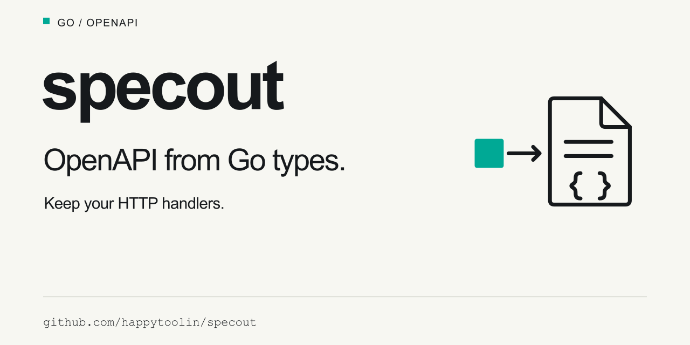

# specout

Generate an OpenAPI 3.1 document from your Go types. Keep your router, your
middleware, and your HTTP handlers.



> **Experimental:** The public API can change. Feedback from real services is
> welcome.

## Why specout

specout adds API documentation to a Go service that already works. You describe
each route with Go types and field tags, and specout builds the document from
them.

Your handlers do not change. They still receive `http.ResponseWriter` and
`*http.Request`, and they still read, validate, and answer each request. You do
not need comment annotations or a code generation step.

specout only describes your API. It does not decode or validate requests, so
your code must enforce what the tags say.

## Install

specout requires Go 1.27 or later.

```sh
go get github.com/happytoolin/specout@latest
```

## Quick start

This service has one route. Save it as `main.go` in your Go module:

```go
package main

import (
	"encoding/json"
	"log"
	"net/http"

	"github.com/happytoolin/specout"
	"github.com/happytoolin/specout/adapters/specoutstd"
)

// GreetRequest describes the request parameters.
type GreetRequest struct {
	Name     string `path:"name" jsonschema:"minLength=1,maxLength=40"`
	Language string `query:"language,omitempty" jsonschema:"enum=en|es,default=en"`
}

// Greeting is the response body.
type Greeting struct {
	Message string `json:"message"`
}

// Problem is the error body.
type Problem struct {
	Error string `json:"error"`
}

// greet is a normal net/http handler. It reads and checks its own input.
func greet(w http.ResponseWriter, r *http.Request) {
	w.Header().Set("Content-Type", "application/json")
	name := r.PathValue("name")
	switch r.URL.Query().Get("language") {
	case "", "en":
		json.NewEncoder(w).Encode(Greeting{Message: "Hello, " + name})
	case "es":
		json.NewEncoder(w).Encode(Greeting{Message: "Hola, " + name})
	default:
		w.WriteHeader(http.StatusBadRequest)
		json.NewEncoder(w).Encode(Problem{Error: "language must be en or es"})
	}
}

func main() {
	doc := specout.New(specout.Config{Title: "Hello API", Version: "1.0.0"})
	mux := http.NewServeMux()
	routes := specout.Bind(doc, specoutstd.New(mux))

	routes.Get("/hello/{name}", specout.Handler[GreetRequest, Greeting]{
		HandlerFunc: greet,
		Summary:     "Say hello",
		Responses:   []specout.Response{{Status: http.StatusBadRequest, Type: Problem{}}},
	})

	spec, err := doc.Build() // after all routes; a bad document fails here
	if err != nil {
		log.Fatal(err)
	}
	mux.HandleFunc("GET /openapi.json", func(w http.ResponseWriter, _ *http.Request) {
		w.Header().Set("Content-Type", "application/json")
		w.Write(spec)
	})

	log.Fatal(http.ListenAndServe("localhost:8080", mux))
}
```

Start the service:

```sh
go run .
```

Call the route:

```sh
curl 'http://localhost:8080/hello/Ada?language=es'
```

```json
{"message":"Hola, Ada"}
```

Get the API document:

```sh
curl http://localhost:8080/openapi.json
```

The document includes this operation, and a schema for each of the two response
types:

```json
{
  "summary": "Say hello",
  "operationId": "getHelloName",
  "parameters": [
    {
      "name": "name",
      "in": "path",
      "required": true,
      "schema": { "type": "string", "maxLength": 40, "minLength": 1 }
    },
    {
      "name": "language",
      "in": "query",
      "required": false,
      "schema": { "type": "string", "enum": ["en", "es"], "default": "en" }
    }
  ],
  "responses": {
    "200": {
      "description": "OK",
      "content": {
        "application/json": { "schema": { "$ref": "#/components/schemas/Greeting" } }
      }
    },
    "400": {
      "description": "Bad Request",
      "content": {
        "application/json": { "schema": { "$ref": "#/components/schemas/Problem" } }
      }
    }
  }
}
```

## Compare with other tools

specout documents the API that you already have. Huma and Fuego are frameworks
that also decode and validate requests for you. swag reads comment annotations.

Two features are specific to specout. It finds routes that have no
documentation, and it compares the statuses in your HTTP tests with the document.

| | specout | [Huma](https://huma.rocks/) | [Fuego](https://github.com/go-fuego/fuego) | [swag](https://github.com/swaggo/swag) |
|---|---|---|---|---|
| **Handlers** | | | | |
| Plain `net/http` handlers | Yes | No, it uses its own handler signature | Yes, with `GetStd` | Yes |
| Describe the API with | Go types and tags | Go types and tags | Go types and route options | Comments |
| Build step | None | None | None | `swag init` |
| Decodes and validates requests | No, your handlers do | Yes | Yes | No |
| **OpenAPI** | | | | |
| Document version | 3.1.0 | 3.1.0, and also 3.0.3 | 3.1.0 | 2.0, or 3.1.0 with `--v3.1` on v2 RC |
| Cookie parameters | Yes | Yes | Yes | No |
| Discriminated unions | Yes, from Go types | Yes, with a handwritten schema | No | Yes, with `@Discriminator` on v2 RC |
| Callbacks | Yes, from Go types | Yes, with a handwritten object | No | No |
| **Checks** | | | | |
| Find routes with no documentation | Yes | No | No | No |
| Compare test statuses with the document | Yes | No | No | No |

Router support:

| Router | specout | Huma | Fuego |
|---|---|---|---|
| `http.ServeMux` | Yes | Yes | Yes |
| chi v5 | Yes | Yes | No |
| gorilla/mux | Yes | Yes | Yes |
| Echo v5 | Yes | Yes | No |
| Echo v4 | Yes | Yes | Yes |
| Gin | Yes | Yes | Yes |
| Fiber v3 | Yes | Yes | No |
| Fiber v2 | No, Fiber deprecated it | Yes | No |
| httprouter, BunRouter, Flow | No | Yes | No |

swag reads comments, so it works with any router.

A dash means that we did not find the feature in the tool's documentation or
source. We checked Huma v2.40.0, Fuego v0.21.0, and swag v1.16.6 and
v2.0.0-rc6 on 2026-10-30. These tools change, so check their documentation
before you choose.

Choose specout to add documentation and keep your current request handling code.
Choose Huma or Fuego if you want the framework to decode and validate requests.

## Features

| Area | Support |
|---|---|
| Output | OpenAPI 3.1 and JSON Schema 2020-12, as JSON in a stable order. |
| Parameters | Path, query, header, and cookie. |
| Request bodies | JSON, binary files, multipart uploads, and custom media types. |
| Responses | Status codes, headers, media types, shared errors, links, and responses without a body. |
| Schemas | Nested and recursive types, collections, optional fields, nullable values, enums, formats, value limits, and discriminated unions. |
| Authentication | Bearer tokens, HTTP Basic, API keys, OAuth 2.0, OpenID Connect, and mutual TLS. Your middleware checks the credentials. |
| Route details | Summaries, descriptions, tags, operation IDs, deprecation, examples, and security for each route. |
| Requests your API sends | Webhooks and callbacks, with schemas from Go types. |
| Checks | Find routes without documentation, and compare response statuses with your HTTP tests. |
| Valid output | specout stops with a fix on a value that would make the document break OpenAPI 3.1 or JSON Schema 2020-12. |

## Describe your API

### Requests

A field tag gives the location of each request value. A field with no location
tag is part of the JSON request body:

```go
type UpdateItemRequest struct {
	ID      int64   `path:"id" jsonschema:"format=int64,description=Item ID"`
	DryRun  bool    `query:"dry_run,omitempty"`
	TraceID string  `header:"X-Trace-ID,omitempty"`
	Session string  `cookie:"session,omitempty"`
	Name    string  `json:"name" jsonschema:"minLength=1"`
	Price   float64 `json:"price" jsonschema:"minimum=0"`
}
```

Here, the first four fields become parameters. The request body has only `name`
and `price`.

| Tag | What it describes |
|---|---|
| `path`, `query`, `header`, `cookie` | The location of a parameter. |
| `json` | The name of a body field. `omitempty` makes the field optional. |
| `form` | The name of a field in a form or multipart body, when it is not the JSON name. |
| `jsonschema:"minLength=1,maxLength=40"` | The length limits of a string. |
| `jsonschema:"minimum=1,maximum=3"` | The limits of a number. |
| `jsonschema:"minItems=1,maxItems=3"` | The length limits of an array. |
| `jsonschema:"enum=en\|es"` | The allowed values. |
| `jsonschema:"default=en"` | A default value. Your handler must apply it. |

A `specout.File` field makes the request body `multipart/form-data`:

```go
type UploadAvatar struct {
	ID     string       `path:"id"`
	Avatar specout.File `json:"avatar"`
	Note   string       `json:"note,omitempty"`
}
```

### Responses

The second type of `specout.Handler` is the success response: a `200` with that
body, or a `204` when the type is `specout.NoContent`. Add other responses with
`Responses`:

```go
doc := specout.New(specout.Config{
	Title: "Items API", Version: "1.0.0",
	ErrorType: Problem{}, DefaultErrors: []int{http.StatusInternalServerError},
})

routes.Post("/items", specout.Handler[CreateItem, Item]{
	HandlerFunc: createItem,
	Responses: []specout.Response{
		{Status: http.StatusCreated, Headers: []specout.Header{{Name: "Location", Required: true}}},
		{Status: http.StatusBadRequest},
	},
})

routes.Delete("/items/{id}", specout.Handler[struct{}, specout.NoContent]{
	HandlerFunc: deleteItem,
	Responses:   []specout.Response{{Status: http.StatusNotFound}},
})
```

A declared success response replaces the `200` or the `204`. A success response
is a `2xx`, a redirect (a `3xx` other than `304`), or a `101`. In the example,
the `201` replaces the `200`, and the `204` stays next to the `404`.

A response with no `Type` gets the body of its status:

| Status | Body |
|---|---|
| `2xx` | The second type of the handler. |
| `4xx`, `5xx`, and `Key: "default"` | `Config.ErrorType`. With no `ErrorType`, the response has no body. |
| Any other status | No body. |

Set `Type` to give a response another body. Set `Type: specout.NoContent{}` for
a response with no body. Set `Omit: true` to remove a response, such as a status
from `DefaultErrors`. A route with `Public: true` does not get the `401` and
`403` from `DefaultErrors`.

Use `struct{}` as the request type for a route with no request data. Use
`specout.NoContent` as the response type for a route with no response body. Use
`specout.File` as the type of a binary body, and `ContentTypes` for its media
types:

```go
routes.Get("/report", specout.Handler[struct{}, specout.File]{
	HandlerFunc: getReport,
	Responses:   []specout.Response{{Status: http.StatusOK, ContentTypes: []string{"application/pdf"}}},
})
```

Use `Request` to describe the request body, in the same way:

```go
routes.Post("/items", specout.Handler[CreateItem, Item]{
	HandlerFunc: createItem,
	Request: specout.Request{
		Description: "The new item",
		Examples:    map[string]specout.Example{"lamp": {Value: CreateItem{Name: "Lamp"}}},
	},
})
```

`Examples` gives each example a name. `Response` has the same `Examples` field.

### Requests your API sends

A webhook is a request that your API sends on its own, such as an order event.
Describe it as you describe a route, but give it a name and no handler. The
request type is what your API sends:

```go
type OrderCreated struct {
	Signature string `header:"X-Signature"`
	OrderID   string `json:"orderId"`
}

doc.Webhook(http.MethodPost, "orderCreated", specout.Handler[OrderCreated, specout.NoContent]{
	Summary: "An order was created",
})
```

The response type `specout.NoContent` means that the receiver answers `204`
with no body. Add
`Responses` if the receiver can answer in another way. A declared success
response replaces the `204`. For example, use `Key: "2XX"` for any success
status.

A callback is a request that your API sends because of one route. The URL is
usually a runtime expression that reads the original request:

```go
jobDone := specout.NewCallback(
	http.MethodPost, "jobDone", "{$request.body#/callbackUrl}",
	specout.Handler[JobResult, specout.NoContent]{Summary: "The job finished"},
)

routes.Post("/jobs", specout.Handler[StartJob, Job]{
	HandlerFunc: startJob,
	Callbacks:   []specout.Callback{jobDone},
})
```

Webhooks and callbacks take the same fields as a route, such as `Summary`,
`Responses`, and `Request`. These rules are different from a route:

- They stay out of the route checks and the status comparison, because your
  API does not serve them.
- They do not get `DefaultErrors`, because those errors come from your API.
- They do not need `Auth` from `Config`. Set `Security` if your API uses one of
  those schemes to send the request.

### Links between operations

A link tells a client how to use a response in a next request. The build fails
if no operation has the operation ID in the link:

```go
routes.Post("/jobs", specout.Handler[StartJob, Job]{
	HandlerFunc: startJob,
	Responses: []specout.Response{{
		Status: http.StatusOK,
		Links: map[string]specout.Link{
			"status": {
				OperationID: "getJob",
				Parameters:  map[string]string{"id": "$response.body#/id"},
			},
		},
	}},
})

routes.Get("/jobs/{id}", specout.Handler[struct{}, Job]{HandlerFunc: getJob, OperationID: "getJob"})
```

### Form fields and servers

Use `Request.Encoding` to describe the fields of a form or multipart request
body. A wrong field name panics at registration:

```go
Request: specout.Request{
	Encoding: map[string]specout.Encoding{
		"avatar": {ContentType: "image/png"},
		"labels": {Style: "pipeDelimited", Explode: new(false)},
	},
},
```

Use `Handler.Servers` when one route has a different base URL from the rest of
the API.

### The whole API

Only `Title` and `Version` are required in `specout.Config`. Add other fields
when your API needs them:

| Field | Purpose |
|---|---|
| `Description`, `Contact`, `TermsOfService`, `License` | Give general information about the API. |
| `ExternalDocs` | Link to an API guide. |
| `Servers` | List the base URLs of the API. This does not change the server address or the route paths. |
| `Tags` | Describe each group of routes. Use `Handler.Tags` to put a route in a group. |
| `Auth` | Describe authentication. Your middleware must check the credentials. |
| `ErrorType`, `DefaultErrors` | Describe a shared error body and its status codes. Your handlers write these responses. |
| `ClosedSchemas` | Mark object schemas as closed to unknown fields. Your code must reject those fields. |

### Types with custom JSON

specout builds a schema from the Go fields of a type. A type with its own
`MarshalJSON` method can write a different shape, and specout cannot see that
shape. Give the type a `JSONSchema()` method. `specout.Schema` is the schema type
of [invopop/jsonschema](https://github.com/invopop/jsonschema):

```go
// Money.MarshalJSON writes a string such as "12.50".
func (Money) JSONSchema() *specout.Schema { return &specout.Schema{Type: "string"} }
```

Use `specout.Enum` for a list of values that several fields share. Each field,
parameter, and body of the type then gets the same list:

```go
type Status string

func (Status) JSONSchema() *specout.Schema { return specout.Enum("todo", "doing", "done") }
```

Schemas describe the output of `encoding/json`. `encoding/json/v2` writes some
values differently. For example, it writes a `[N]byte` array as a base64 string,
and a nil slice or map as an empty value instead of `null`.

## Use your router

| Router | Function | Package |
|---|---|---|
| `http.ServeMux` | `specoutstd.New` | `github.com/happytoolin/specout/adapters/specoutstd` |
| chi | `specoutchi.New` | `github.com/happytoolin/specout/adapters/specoutchi` |
| gorilla/mux | `specoutgorilla.New` | `github.com/happytoolin/specout/adapters/specoutgorilla` |
| Echo v5 | `specoutecho.New` | `github.com/happytoolin/specout/adapters/specoutecho` |
| Echo v4 | `specoutechov4.New` | `github.com/happytoolin/specout/adapters/specoutechov4` |
| Gin | `specoutgin.New` | `github.com/happytoolin/specout/adapters/specoutgin` |
| Fiber v3 | `specoutfiber.New` | `github.com/happytoolin/specout/adapters/specoutfiber` |

`specoutstd` is part of the core module. Each other adapter is a separate Go
module, so the core module does not depend on a router. Add the adapter for
your router:

```sh
go get github.com/happytoolin/specout/adapters/specoutgin@latest
```

`specout.Bind` takes the adapter of your router, and the code after it is the
same on every router. This example uses Gin:

```go
doc := specout.New(specout.Config{Title: "Inventory API", Version: "1.0.0"})
engine := gin.New()

routes := specout.Bind(doc, specoutgin.New(engine.Group("/v1")))
routes.Get("/items/:id", specout.Handler[GetItemRequest, Item]{
	HandlerFunc: getItem,
	Summary:     "Get an item",
})

if err := specout.Check(doc, specoutgin.New(engine), "/openapi.json"); err != nil {
	log.Fatal(err)
}
```

The routes use the syntax of the router, such as `:id` on Gin. For another
router, change only the adapter, as in `specoutchi.New(r)` or
`specoutecho.New(e.Group("/v1"))`. Put route middleware on a router group, and
make the adapter from that group, as in `engine.Group("/admin", requireAdmin)`.

A chi router does not know the prefix where it is routed or mounted. Pass the
prefix to `specoutchi.New`:

```go
r := chi.NewRouter()
r.Route("/v1", func(r chi.Router) {
	routes := specout.Bind(doc, specoutchi.New(r, "/v1"))
	routes.Get("/items/{id}", specout.Handler[GetItemRequest, Item]{HandlerFunc: getItem})
})
```

If the prefix is wrong, `Check` on the root router reports the real path as
undocumented.

The document shows each path in OpenAPI form, so `/items/:id` becomes
`/items/{id}`. Your handler reads the value with `r.PathValue("id")` on every
router.

For another router, write an adapter: a type with the two methods of
`specout.Router`. Or register the handler on the router, and call
`doc.Document` to record its documentation. The `Document` path uses OpenAPI
syntax, such as `/items/{id}`. To request an adapter, open an
[issue](https://github.com/happytoolin/specout/issues).

### Encoded path values

A request for `/users/a%40b` gives one of these values:

| Router | Value of `r.PathValue` | To get `a@b` |
|---|---|---|
| `http.ServeMux`, gorilla/mux, Gin | `a@b` | No action. |
| Echo v5 | `a%40b` | Set `UnescapePathParamValues` in `echo.RouterConfig`. |
| Fiber | `a%40b` | Set `UnescapePath` in `fiber.Config`. |
| Echo v4, chi | `a%40b` | Call `url.PathUnescape` on the value. |

Two router settings keep the value encoded:

- gorilla/mux with `UseEncodedPath`.
- Gin with `UseRawPath` or `UseEscapedPath`, and `UnescapePathValues` cleared.

### Paths

- A path with an empty segment (`//`) or a dot segment (`/.`, `/..`) panics when
  you register it. Clients remove those segments, so the document would show a
  different path.
- The document leaves out catch-all routes, such as `/files/*` in chi or
  `/files/{path...}` in `http.ServeMux`. A chi or gorilla/mux parameter with a
  regex, such as `/files/{name:.+}.json`, is a normal path parameter in the
  document, also when the regex can match a `/`.
- `http.ServeMux` serves `/a/{$}` for `/a/` only, and `/a/` for every path below
  it. The document shows `/a/{$}` as `/a/`. It leaves out `/a/`, because
  OpenAPI has no form for a path that serves every path below it.

## Serve or export the document

`Build` returns the document as indented JSON. Serve the bytes on a route of
your router, or write them to a file:

```go
spec, err := doc.Build()
if err != nil {
	return err
}
engine.GET("/openapi.json", func(c *gin.Context) { c.Data(200, "application/json", spec) })
```

Register all routes first. You cannot add routes after a successful build.

### When something is wrong

| Problem | Result |
|---|---|
| Bad `Config` | `specout.New` panics. |
| Bad route data | The registration panics, and the router does not get the route. |
| Bad path | The registration panics. A router adapter checks the full path after the router adds the route, so the router has the route. |
| Failed build, with `Build` | The call returns an error that lists every problem. If the build panics, the call panics. |

Call `doc.Build()` at startup or in a test, so that a bad document fails
there.

Each message starts with the place of the problem, and it gives the fix when
specout knows it:

```text
specout: POST /jobs: response 200: link "status": no operation has operationId "getJb"; set OperationID on the target route; did you mean "getJob"?
```

specout also panics on a `jsonschema` keyword that it does not know, such as
`minLenght=1`. The tag parser ignores such a keyword, so the rule would be
missing from the document.

The document must stay valid OpenAPI 3.1 and JSON Schema 2020-12. Thus specout
also stops on these values:

| Value | Example |
|---|---|
| A `default` or `example` that its own schema rejects | `enum=en\|es,default=de` |
| A schema keyword with a value that is not valid | `pattern=(a`, `multipleOf=0`, a repeated enum value |
| A `jsonschema_extras` key with a checked form, or a 3.0 keyword | `required=true`, `nullable=true` |
| A header parameter that OpenAPI ignores | `Accept`, `Content-Type`, `Authorization` |
| A style that does not fit the parameter type | `style=deepObject` on a string |
| A body that cannot carry its files, or a `TRACE` body | A `File` field with `application/json` |
| A media type that is not `type/subtype`, or a repeated media type | `json` |
| A path with a query, a fragment or a space | `/items?x=1` |
| A `$ref` that points to nothing | `oneof_ref=#/$defs/Missing` |
| A `Raw` value that breaks the object it replaces | A Raw response with no `description` |
| A URL or an email address that is not valid | `Contact.Email: "nobody"` |

A list default in a tag, such as `default=1` on a `[]int`, becomes `[1]`.

Some path checks need the full path, and the router knows it only after it
adds the route. Thus `Bind` checks the path after the router adds the route,
and the router has the route when the panic occurs.

## Check your documentation

### Find routes without documentation

`specout.Check` returns an error that names each route with no documentation.
It works with chi, gorilla/mux, Echo, Gin, and Fiber. Give `Check` the adapter
of the root router and the paths to skip, such as the path of the document
itself. Use the same check in a test:

```go
func TestRoutesAreDocumented(t *testing.T) {
	require.NoError(t, specout.Check(doc, specoutgin.New(engine), "/openapi.json"))
}
```

Call `Check` after you register the routes. `http.ServeMux` cannot list its
routes, so `Check` returns an error for it. Use the recorder to find its routes
that have no documentation.

### Compare response statuses with your tests

The optional `recorder` package records the response statuses of your HTTP tests.
`recorder.Verify` then checks that each declared status occurred, and that the
document declares each status that occurred. It does not check response bodies.

```go
func TestStatuses(t *testing.T) {
	rec := recorder.New(mux, "/openapi.json")
	rec.ServeHTTP(httptest.NewRecorder(), httptest.NewRequest(http.MethodGet, "/hello/Ada", nil))
	rec.ServeHTTP(httptest.NewRecorder(), httptest.NewRequest(http.MethodGet, "/hello/Ada?language=fr", nil))
	require.NoError(t, recorder.Verify(doc, rec))
}
```

`recorder.Verify` returns an error that lists each problem on one line.

With chi, gorilla/mux, Echo, Gin, and Fiber, use `recorder.New(nil)` and
install the adapter's `Record` middleware. With chi, register it before the
routes, as in `r.Use(specoutchi.Record(rec))`. Give `recorder.New` the paths to
skip, as in `recorder.New(nil, "/openapi.json")`.

For `http.ServeMux`, the recorder reads the pattern of the route that ran. You
can pass the production handler, with its middleware, to `recorder.New`.
Middleware outside the router hides the route of a request, so `Verify` finds
the route from the request path. A `401` from an auth middleware then counts for
the route. A request for the document itself is not drift.

A handler that hijacks the connection writes its own response. If the handler
wrote no status and the request asks to switch protocols, as in a WebSocket
handshake, the recorder records `101`. It records nothing for any other hijack
that wrote no status.

## Learn more

- [Runnable examples](examples/README.md)
- [Sample API document](examples/onboarding/openapi.json)
- [Types and responses](skills/specout/references/types-and-responses.md)
- [Routers and checks](skills/specout/references/routers-and-verification.md)
- [Configuration and authentication](skills/specout/references/configuration.md)
- [OpenAPI 3.1 field coverage](skills/specout/references/openapi-coverage.md)

Coding agents can use the optional [specout skill](skills/specout/SKILL.md):

```sh
npx skills add happytoolin/specout --skill specout
```

## Contribute

Feedback and contributions are welcome, and so are new router adapters. Read the
[code guide](CONTRIBUTING.md) for the file layout.

```sh
just check    # Run all CI and release checks.
just lint     # Check Go lint rules and formatting.
just nilaway  # Find code that can panic on nil.
just demo     # Run the onboarding example.
```

`just check` requires Go, Python 3, and Node.js with npm.

## License

[Apache 2.0](LICENSE)
